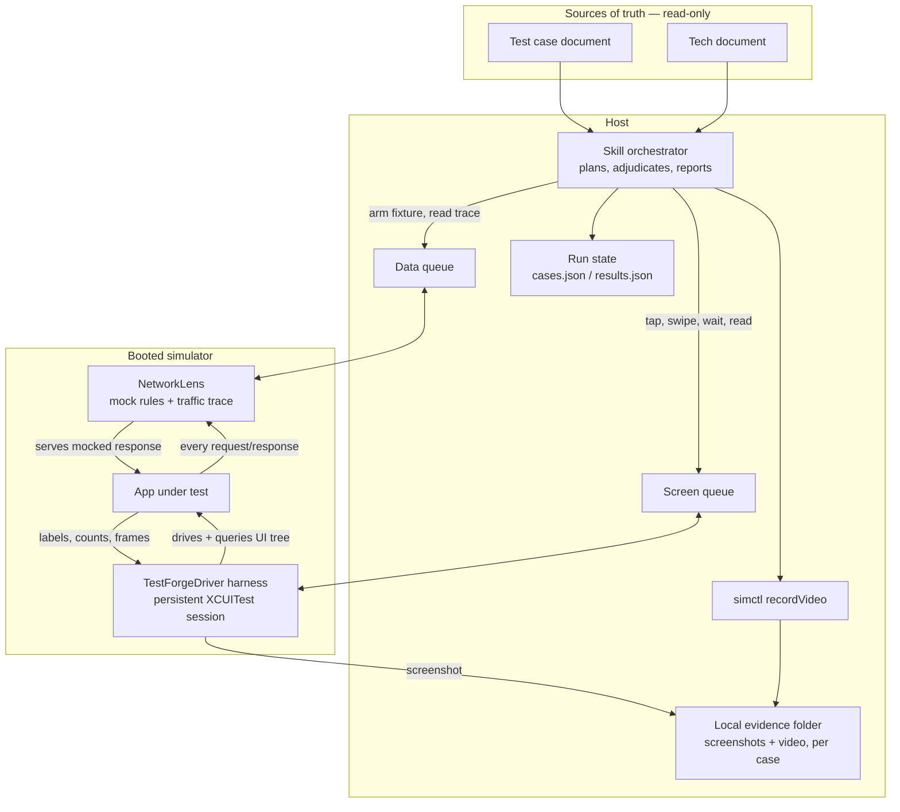
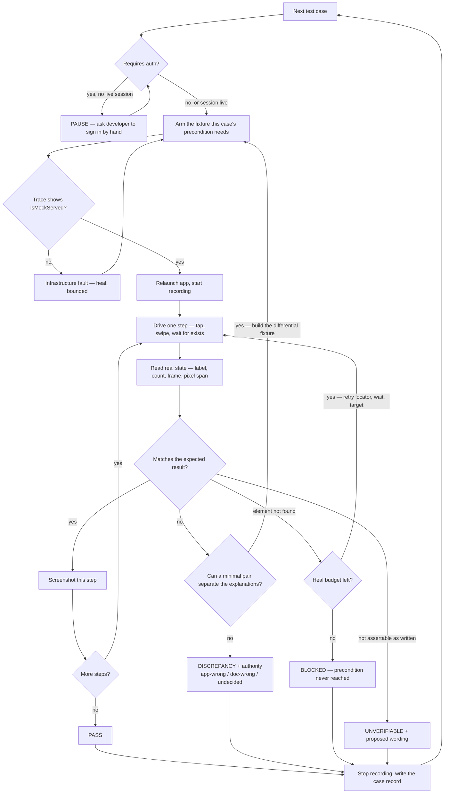
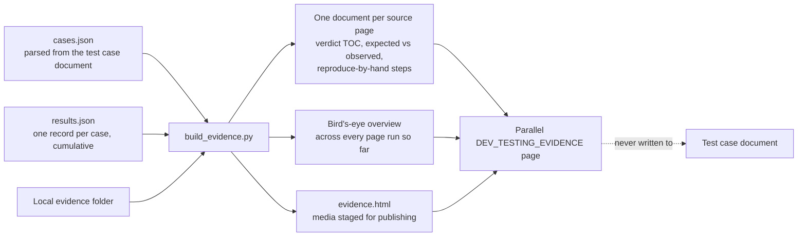

# Test Flow Recorder — what it does, and what it is worth

A QA test case is a paragraph of English. Turning it into a verdict normally costs a person twenty
minutes: arrange the data, reach the screen, read the result, decide whether the app or the sheet is
wrong, screenshot it, write it up. This skill does that loop against a running app, one case at a
time, and leaves behind evidence a reviewer can check without rerunning anything.

It is **not** a test-code generator. Nothing is compiled, and no `<Screen>TestForgeTest.swift` is emitted. A
run is a live conversation with the app: arm the data, drive the screen, read what actually came
back, adjudicate, record. That distinction is the whole design — a generated test asserts what its
author believed; a live run reports what the app did.

---

## Minimum inputs

Two documents. Both are read-only for the entire run.

| Input | What it supplies | Without it |
|---|---|---|
| **Test case document** (Confluence page or child pages) | the cases: scenario, precondition, steps, expected result, API column | there is nothing to check against — the run cannot start |
| **Tech document** (the feature's own `docs/`, HLD, or API contract page) | file paths, the endpoint list, auth requirements, thresholds and config keys | the run still works, but every finding is capped at `undecided` — see *The adjudication ceiling* |

Both are **co-equal sources of truth**. When they disagree, that disagreement *is* the finding, and
which side is wrong is decided on evidence rather than assumed. A test case that specifies one date
format while the tech document and the formatting constant both specify another is a defect in the
test case, and the run says so — with all three quoted. An automated test written from that same
sheet would have failed and blamed the app.

Scope with no tech document is supported (`scan_scope.py` classifies it as `undocumented`), but that
is the exception, not the working mode. It exists so a legacy page can be brought under coverage —
and its findings are labelled accordingly.

---

## What makes it different

**1. Fixtures are built on the fly, from real responses.**
Most QA automation waits for the backend to be in the right state. This one puts the backend in the
right state. A baseline is *captured* from a real 200 (`capture_baseline.py`), then mutated into the
variant a case needs (`make_variants.py`) — empty list, one field removed, a threshold at 96 instead
of 50, a five-second delay, a 500. A fixture authored from a model instead of a captured body is
marked `provenance: authored` and treated as suspect: a hand-written body that omits one optional
field the UI depends on produces a symptom (a header that will not navigate, a badge that never
appears) indistinguishable from a real bug.

**2. Proof of mock, not a claim of mock.**
The most expensive failure mode in this kind of tooling is a data layer that reports "armed" while
the app talks to the real backend. Preflight refuses to run a case until the trace shows
`isMockServed: true` for the endpoint just armed. Not a status flag — the traffic itself.

**3. Discrepancies carry an authority, not just a diff.**
`app-wrong`, `doc-wrong`, or `undecided`, with `undecided` as the default and `app-wrong` requiring a
tech document or a developer's ruling. This is what stops a QA sheet from silently becoming a spec.
Most discrepancies in a real run do not qualify for `app-wrong`, and the report says so rather than
overstating what the evidence supports.

**4. Differential fixtures.**
A single fixture that two explanations both predict proves neither. Where a minimal pair is possible
the run builds it: same body, one field changed. Pagination is the clean example — the same endpoint
served with `total_page: 3` and with `total_page: 1`; the second request fires in one and not the
other, which proves the client stops *because the response said so* rather than because the scroll
never reached the threshold.

**5. It heals the harness, never the expectation.**
Identifiers, waits, targets and fixtures self-heal within bounds. A value the app renders never does.
A heal that does not change the verdict is rolled back, so three failed attempts do not leave three
unrelated edits behind.

---

## Productivity, and what it actually buys

The saving is not typing. It is the setup-and-adjudication tax, paid per case:

| Step, done by hand | Done here |
|---|---|
| Read the sheet, find the screen's files | `scan_scope.py` plus the tech document, once per scope |
| Get the backend into the case's state | a captured baseline mutated into the variant, armed and proven served |
| Reach the screen, drive the steps | a command plan against the live app, waits polling real UI state |
| Decide whether the app or the sheet is wrong | verdict plus authority, with both sides quoted and attributed |
| Screenshot, name it, write it up | evidence captured per attempt; the report generated, never hand-written |

A whole page of cases parses unattended, so the expensive part becomes deciding which findings matter
rather than producing them. The output is not "N tests passed" — it is a set of findings that each
name a cause. A discrepancy worth its place in a report reads like *this section is unreachable
because it sits in the `else` of a condition every card on this surface satisfies*, and it points at
the line. That is not something a screenshot comparison finds.

What it does **not** save: the thinking. Deciding whether a discrepancy is a bug is still a person's
call. The skill's job is to make that call take a minute instead of an afternoon.

---

## How it drives the app

Two command queues, one booted simulator. Nothing is compiled per flow — the skill posts commands and
reads what comes back.



The two planes are what make a verdict trustworthy. The screen plane says what the user sees; the
data plane says what the app was actually given. A case that checks an empty state is only meaningful
if the trace confirms the empty body was the one served — which is why the data plane is queried for
`isMockServed: true` before the screen plane is touched at all.

The harness is generic and built once. It knows no test case: it polls for commands, dispatches on
`kind`, and posts results back. Every flow, in every feature, runs through the same session until it
has been idle 30 minutes.

---

## The per-case loop

Each test case runs this loop. Every branch that ends the case writes one record to `results.json`.



Three properties of that loop are worth stating plainly:

- **Healing only ever moves left of the assertion.** Locators, waits, targets and fixtures are
  retried; the expected value never is. A heal that does not change the verdict is rolled back.
- **A discrepancy is not the end of the case.** The loop asks whether a minimal pair of fixtures
  could separate two explanations, and if it could, it builds it and runs again. Only an explanation
  no fixture can separate is recorded as-is.
- **Recording brackets the attempt, not the case.** A case that passed on the third attempt produces
  three files, and the attempt sequence is the only record of what the healing actually did.

---

## From results to a readable report

Nothing in the report is written by hand. The generator is the only author, so the prose and the
numbers cannot drift apart.



`cases.json` and `results.json` live outside the repo and accumulate across runs, which is what lets
the overview be regenerated from every page at once rather than stitched together. The dotted edge is
a rule, not a diagram artefact: the test case document is never mutated by a run.

---

## A run, stage by stage

### Stage 1 — Preflight, fails closed

```bash
scripts/preflight.py --endpoint "<each armed endpoint>" \
    --manifest fixtures/<feature>/manifest.json --responses-dir fixtures/<feature>/api-responses \
    [--mcp-container "<path the data channel reports>"] [--rule <candidate>.json]
```

Eight gates, exit 1 if any fails: device unambiguous, driver reachable (by a **real command**, never
a status flag), media roots agree, data channel, container freshness, rule schema, **proof of
mock**, fixture health.

The rule-schema gate earns its place on its own. A single hand-written rule with a malformed id, no
`match`, or a variant missing a required field makes the app drop **every** rule it holds, silently —
which presents as "mocking is broken" and costs a session to diagnose. The gate names each offending
field before the rule is installed.

### Stage 2 — Shape the work

The developer is asked, in one prompt, the two questions that decide the entire output layout:

> **Feature shape** — Revamp · Multi-section feature · Single-section feature · New page
> **Test case source** — Group of pages (give the main page) · Single page

Group answers need only the *parent* page; children are discovered automatically. A revamp claiming a
single source page is re-checked, because that usually means someone pasted the parent URL without
realising the cases live on its children.

### Stage 3 — Command plan

The test case becomes an ordered list of driver and data-layer calls. It is **data, not code**: no
file is written, nothing is built. Every wait polls real UI state — there is no sleep command in the
vocabulary, deliberately.

### Stage 4 — Execute and record

One command at a time, because a step's outcome usually decides whether the next step means anything.
After each step the run reports what the tool actually returned (`{count: 5}`, `{label: "Tomorrow"}`)
and marks it against the expectation. An infrastructure failure is called an infrastructure failure,
never a test failure.

### Stage 5 — Adjudicate

Verdict plus authority. Where a pair of fixtures could separate two explanations and was not built,
the verdict is not recorded.

### Stage 6 — Report

`build_evidence.py` emits it. Never hand-written.

### Stage 7 — Publish

A parallel `DEV_TESTING_EVIDENCE` page beside the test case document. **The test case document is
never written to** — no `updateConfluencePage` on it, no id minted into it, no platform marking.

---

## Where it pauses, and what it asks

Four pause points. Everything else runs unattended.

**1. Shape of the work** — before anything runs (Stage 2, above).

**2. Accessibility identifiers.** When a case needs an element that carries no identifier, every
proposal is batched into one prompt naming the exact constant and the file and line it would land in.
Nothing is inserted silently, and a batched "yes to all" still lists what is being added. Anything
declined is recorded as an unrunnable step rather than guessed at.

**3. The auth gate.** Guest cases run first, in one batch. At the first gated case the run stops and
asks the developer to sign in **by hand**:

> **Authenticated — continue** · **Still authenticating** · **Skip the gated batch**

Login is never automated. The session is re-verified before **each** gated case, not once per batch —
a session dropping partway through a long gated batch would otherwise turn every remaining case into
a confident false discrepancy. Skipping records every gated case `BLOCKED` with the reason.

**4. Legacy scope only.** When no tech document exists, four extra questions up front — expectation
source, addressing strategy, feature switch, preconditions — plus two in prose (entry point, and what
must not be touched). Skipped entirely on documented scope.

Debugging questions are asked in prose, naming the artifact that would settle them, rather than as
pickers.

---

## Screenshots and video

**Every case gets evidence, pass included.** A passing case with no screenshot is indistinguishable
from a case nobody ran.

| | |
|---|---|
| Screenshot | `test_forge_screenshot` with `caseId` → `~/Documents/<Team>-Test/<caseId>/<step-n>-<label>.png`. Pass `caseId` every time — one harness session serves every case, so without it a whole suite's screenshots pile into one folder named after the harness's test method. |
| Recording | `test_forge_start_recording` / `test_forge_stop_recording` bracket a case → `<caseId>.mov`, host-side `simctl io recordVideo` (hevc). Needs no harness and **survives an app relaunch mid-case**, which is what makes a fixture-swap sequence recordable end to end. Stopping is mandatory; a recording never stopped leaves an unplayable file. |
| Per attempt | Recording is per **attempt**, not per case: `<caseId>-attempt<N>-<verdict>.mp4`. A case that passed only after a locator heal is a different result from one that passed first time, and only the attempt sequence shows which. |
| Cost | ~0.4 MB/s — roughly 140 MB for six minutes. A case that spends minutes hunting an element should be diagnosed with a tree dump *outside* a recording, then re-run. |

**Local first, always.** `~/Documents/<Team>-Test/` is the canonical record and is never deleted
after publishing. Confluence gets a copy, and only on the evidence page — never the test case
document, never Slack, never a PR, because these captures can contain real-looking QA-environment
account, order and payment data. The repo receives **documents only**; media is staged outside it, so
a large media directory never lands in a source tree.

---

## Accuracy, and what a verdict actually means

Four verdicts, each with evidence:

| Verdict | Meaning |
|---|---|
| `PASS` | Observed matches expected. |
| `DISCREPANCY` | Observed differs — both sides quoted, each attributed to its source. |
| `BLOCKED` | The precondition could not be reached, so the expectation was never exercised. |
| `UNVERIFIABLE` | Not assertable as written ("renders correctly", "as per current UI behaviour"). |

`BLOCKED` and `UNVERIFIABLE` are excluded from the pass-rate denominator, so a run that could not
reach half its preconditions cannot flatter itself.

**`UNVERIFIABLE` is the most valuable output, not a failure.** It says a test case cannot be checked
by anyone, automated or not, and it comes with proposed sharper wording.

**Visual expectations become numbers.** "Capped visually at 95%", "does not overflow" — recording
those as unverifiable is usually laziness. `pixel.py` walks a row of pixels and reports colour runs,
so a progress fill becomes `fill / (fill + remainder)` measured in points against a mocked input
value. Two disciplines make that sound rather than suggestive — mock the value that spreads the
candidate explanations furthest apart (a 95% and a 98% cap differ by a handful of points only near
100%), and confirm the element is rendered at all before trusting a span, since a suppressed bar
measures as "no fill".

**What it cannot do.** It cannot tell you whether a discrepancy matters. It cannot prove intent
without a document. On `undocumented` scope `app-wrong` is unreachable from evidence alone, and the
apply-fixes mode declines on posture before it even looks at the pass rate.

---

## Report quality and reliability

One document per source page plus a bird's-eye overview — a single file holding a few hundred cases
is unreadable. Every document opens with a table of contents whose entries carry verdict emoji, so
the state of a long page reads without scrolling.

Each case records: verdict, authority, the fixture and its provenance, expected vs observed with the
source of each, evidence filenames, the machine-readable command trail, **and a "reproduce by hand"
block written in terms of what is on screen** so a manual tester can mimic the run without the
automation.

Reliability properties worth knowing:

- **Attribution is not optional.** Every document names who ran the pass, on what build, commit,
  branch and simulator. A report nobody is named on cannot be followed up.
- **Regenerable.** `cases.json` and `results.json` are kept outside the repo and are cumulative; the
  overview is derived from all of them at once. Throw them away and the next page's run cannot rebuild
  the overview.
- **Re-runs are honest.** Each step carries a content hash, so a re-run reports *which* steps changed
  rather than treating the document as one blob.
- **No absolute home paths**, ever, in anything committed or published.
- **The generator is the only author.** Hand-editing a generated report is how the numbers and the
  documents drift apart.

The apply-fixes mode (`/test-forge-fix`) requires **80% of adjudicated cases passing**, a floor of 10, and a
`documented` posture. A first pass over a feature under active development will usually sit below
that line — which is the gate working, not a number to tune away. Until the surface is stable, fixes
stay proposals reviewed by hand, and that is the expected state rather than a limitation.

When it does open, it applies only the patches the run already proposed, re-runs exactly those cases,
and keeps a patch **only if its case now passes** — a verdict that merely moved is rolled back, as is
an edit whose case never got re-run. What survives is left unstaged for a developer to commit.

---

## Relevance to real QA

The cases are the QA team's own, unedited. The evidence page is a parallel document, so the sheet a
tester works from is never mutated by a developer's run. Every case carries manual reproduction steps,
which means a finding can be handed to QA and checked without this tooling at all. Recommendations
against the test case document are recommendations only — raised, never applied.

Cases are treated as common to iOS and Android as one mobile platform. Nothing is marked
iOS-specific.

---

## Quick reference

```bash
scripts/scan_scope.py <folder>                 # documentation posture, addressability, endpoints
scripts/harness.py ensure                      # restart the driver session, unattended
scripts/dataplane.py <bundle-id>               # resolved data plane, container, trace dir
scripts/preflight.py --endpoint "<path>"       # eight gates, exit 1 on any failure
scripts/capture_baseline.py --endpoint "<path>"  # real 200 -> baseline, timestamps tokenized
scripts/check_baseline.py --manifest <m>       # model-only, body-only and redacted fields
scripts/check_network_trail.py cases.json results.json  # missing/unexpected/duplicate calls per case
scripts/make_variants.py <template> <spec>     # mutate a working fixture into the ones a case needs
scripts/parse_test_cases.py <pages_dir> -o cases.json
scripts/pixel.py <shot> "bar=<x0>,<y>,<x1>:span"  # turn a visual expectation into a measurement
scripts/build_evidence.py cases.json results.json --out-dir <dir> --posture documented
```

Read `SKILL.md` for the stages, `contracts/` for the driver, evidence and healing contracts, and
`platforms/ios.md` for the reference driver and its traps.
